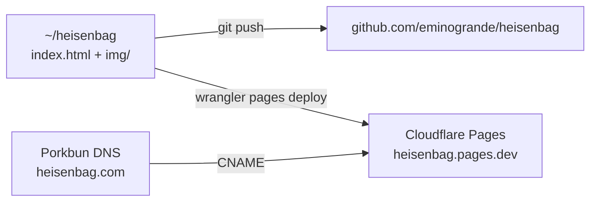

# heisenbag.com

Open-source website for **Heisenbag Shield** — Faraday-cage bags, clothing and shielded spaces, sewn in Berlin.

Static site. No build, no dependencies, one HTML file + hand-drawn illustrations.

## Structure

- `index.html` — the whole shop (21 products + custom work)
- `img/` — charcoal + oil illustrations in the emin.de house style
- `sourcing.md` — shielding fabric research and cost model

## License

MIT. Take it, shield something.
