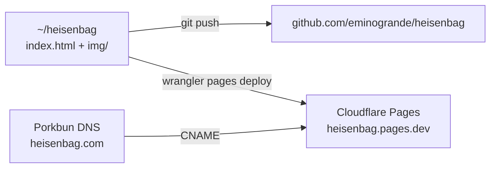

# heisenbag.com

Open-source website for **Heisenbag Shield** — Faraday-cage bags, clothing and shielded spaces, sewn in Berlin.

Static site. No build, no dependencies, one HTML file + hand-drawn illustrations.

## Structure

- `index.html` — the whole shop (24 products + custom work)
- `img/` — charcoal + oil illustrations in the emin.de house style
- `sourcing.md` — shielding fabric research and cost model

## Contact-first update

Custom requests use “Describe your piece” and link directly to `hello@heisenbag.com`.
The AI drawing UI is removed; `/api/draw` returns HTTP 410 without contacting a paid provider.
The contact copy is updated in all 21 locales. No Signal address is configured.
New contact copy follows `write-like-emin`; earlier site copy has not had a full voice pass.
Production remains unchanged until an approved deployment.

## License

MIT. Take it, shield something.
